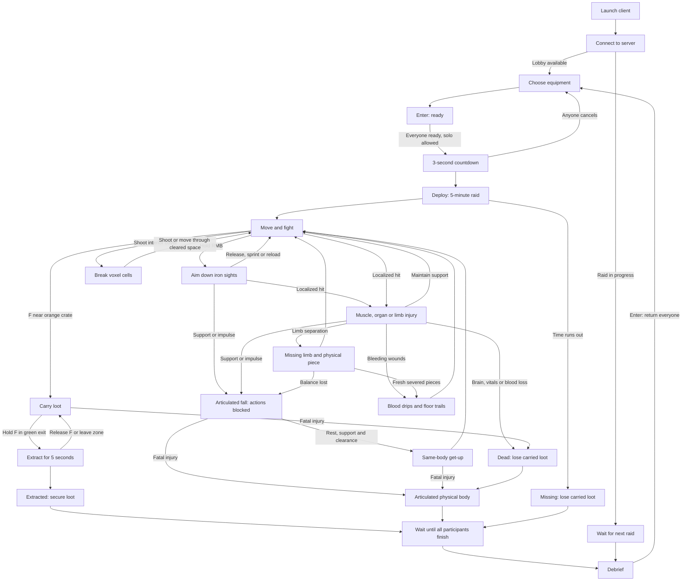

# Game State

TK is a playable, server-authoritative extraction-shooter super alpha. Play solo against two sentries or join the same server with other clients. Choose equipment, ready up, collect loot, survive, and hold the extraction interaction to secure your haul.

## Player flow



## Run a local playtest

Use the repository's Rust nightly toolchain and a GPU supported by Bevy 0.20. From the repository root, start the server in one terminal:

```sh
cargo run --bin server
```

In a second terminal, also from the repository root:

```powershell
cargo run --bin client
```

The client defaults to `127.0.0.1`, UDP port `9080`. No `.env` file is needed, and assets are resolved from the client manifest directory rather than the shell's working directory. For LAN play, set `$env:SERVER_ADDR = "192.168.1.10"` to your server's IP before starting the client (POSIX: `SERVER_ADDR=192.168.1.10 cargo run --bin client`). Allow the server's UDP port through the firewall. Optional `TK_PORT` changes the port on both binaries.

Rebuild both binaries for protocol 8. Close an older server before launching the current build on the same port; the automated harness does not stop a player's existing server.

Start additional clients in separate terminals to test multiplayer. All connected players must ready up; solo play also starts normally. The server supports up to 32 clients and assigns distinct spawn positions. A client arriving during an active raid waits for the next lobby.

### First complete raid

1. In the lobby, choose your equipment with **G/B/H/J**, then press **Enter**. Gear is locked while ready. Press Enter again during the countdown to cancel readiness.
2. After the three-second countdown, you spawn at approximately `x 0 / z 10`, looking toward negative Z. Find an **orange crate**; the nearest is at `x -4 / z 0`. Walk near it and press **F** to pick up one loot unit. A looted crate becomes gray for everyone and remains solid cover.
3. Two **red sentries** guard the yard. Shoot them or use cover. Brown panels and crates are penetrable wood; gray structures are bullet-stopping concrete. Shots break cells out of the wood panels and interior concrete cover. Other players can also hurt you.
4. Return to the **green exit**, centered at `x 0 / z 15`. The HUD shows your position and distance to the exit. Bring at least one loot unit and hold **F** continuously for five seconds inside the green circle. Releasing F or leaving the zone resets progress.
5. The result becomes **Extracted** and your loot is added to **Secured this session** exactly once. If other participants are still playing, wait for them to finish. In **Debrief**, press **Enter** to return everyone to the lobby, then ready up for another raid.

There is no respawn during a raid. Destroyed head/thorax tissue, a destroyed brain, severe blood loss or the five-minute timeout loses carried loot. Secured loot lasts for the current connection/server session.

## Controls

| Input | Action |
| --- | --- |
| Enter | Toggle readiness in lobby/countdown; return everyone to lobby from debrief |
| G / B | In an unready lobby, choose M4A1 or SMG primary / Ball or AP ammo |
| H / J | In an unready lobby, cycle no/light/heavy vest / toggle helmet |
| W, A, S, D | Move |
| Mouse | Look |
| Left Shift / Left Ctrl | Run / crouch |
| Space | Jump while active; never respawn during the current raid |
| Hold Q / E | Gradually lean the view, upper body and firing origin left / right; remote players see the body move with it; release to hold the current angle |
| Tap the opposite tilt key | Ease the view and upper body back to center |
| 1 / 2 | Equip your selected primary / pistol |
| Left mouse button | Hold for rifle/SMG automatic fire; click for pistol semi-automatic fire |
| Hold right mouse button | Aim down iron sights; release to return to hip fire |
| R | Manually reload the selected weapon from finite reserve ammo |
| F | Collect nearby loot; hold in the exit to extract |
| Escape | Release or recapture the cursor during a raid; lobby/debrief release it automatically |
| Up / Down arrow | Narrow / widen the field of view |

## Gameplay

- **Equipment and weapons.** Every loadout has a rifle or SMG plus a pistol. Magazines hold 30/25/17 rounds respectively, with three additional magazine-equivalents in reserve for each equipped weapon. Reload takes 2.4/1.9/1.5 seconds. Switching weapons cancels an unfinished reload. Empty weapons do not auto-reload. Gear is free and restocked for each new raid.
- **Weapon presentation (in progress).** Both perspectives use original stepped M1911, MP5 and M4A1 assemblies and shared grip/muzzle/action anchors. The models were accepted as a first delivery, but the user requested further movement/reload/FOV polish; this is not final artistic acceptance. The rifle is displayed as **M4A1** in the lobby and HUD, with base identity `m4a1`; Pistol/SMG remain class labels. The [weapon reference contract](WEAPON_REFERENCES.md) selects the real 14.5-inch M4A1 and Colt Government .45 ACP targets. Current geometry and gameplay are still provisional: the pistol retains 17 rounds until its mechanical migration. Empty M1911 reloads include an overhand slide release; the MP5 handle retracts/locks and is slapped forward; the M4A1 uses its visible bolt catch. Tactical reload animations do not rack the action; separate authoritative chamber state is still pending. The MP5 handle does not reciprocate on fire. Swaps/interruption blend from the displayed pose. Rifle recoil now applies a spring-driven pitch/yaw to local aim, so the camera, barrel and authoritative shot direction follow the same bounded eight-shot pattern with seeded variation; its default kick is slightly reduced. Confirmed shots eject procedural brass casings sized by weapon class; they tumble/bounce, remain for 60 seconds, and have no active-count cap. Reduced step cadence, centimetre-scale bob and measured turn-rate sway replace rapid oscillation and snapshot pulses. World FOV defaults to 70 vertical degrees and supports 20–160; the weapon projection stays at 65 degrees rather than changing with world zoom. Arrow-key adjustment is time-based. First-person pistol reload cant pivots about the receiver, and its weapon/gloves/visible magazine fit the final viewport without changing the lens; sleeves remain attached and ADS stays centred. The framing correction eases away during deliberate lowering. Candidate17's inspected native reload frames no longer show16's right-edge pistol crop; normal-speed review and final artistic acceptance remain pending.
- **Aim down sights.** Hold **RMB** to raise the current weapon onto its actual iron sights, ease world zoom to 52 degrees for the pistol or 44 for primaries, hide the centre dot and reduce weapon bob/mouse sensitivity. Release to ease back to the selected FOV. Sprinting, reload, fall, death or loss of captured active input lowers the sights, including the support-controller fallback at the physical-piece budget. The server replicates aim, centres the aimed barrel on the weapon's shared sight placement and retains cover obstruction checks. Hip-fire origin, ammunition, damage, cadence and reload durations are unchanged; ADS grants no new damage or spread bonus.
- **Ammo and penetration.** Ball is the default. AP has 1.8 times the penetration and 85% of the damage. Projectiles travel from the offset barrel, drop under gravity, and use continuous map ray casts plus posed anatomical boxes. At point blank, the server first resolves actual body/cover between eye and muzzle, then continues the unchanged muzzle ray if clear; the broad movement capsule no longer shifts an offset-aimed shot back to the eye. A ray between limbs continues to the map or another actor. Wood costs 20 penetration units per metre, once per surface across clearance and flight; concrete stops rounds. A barrel pushed through cover or a nearby body cannot bypass it. Impact marks are smaller and weapon-sized: 25 mm for pistol, 35 mm for SMG, and 50 mm for rifle. Shots are temporarily **silent**, including sentries. Confirmed shots retain flash, damped weapon recoil, bolt motion, tracers and impact marks; rejected triggers produce none of that firing feedback. The red laser remains cosmetic.
- **Body damage and armor.** Live anatomy has head (35), thorax (85), abdomen (65), separate left/right arms (60 each) and separate left/right legs (70 each). Muscle strength is regional. Leg injury reduces speed/jump and changes that side's gait; further injury never restores speed. Arm injury slows reload and increases weapon sway. Losing the trigger arm disables firing/reload and hides the unusable view weapon; an absent support hand disappears from the first-person view. Vests cover the thorax and helmets cover the head. Armor resolves once per impact: stopped rounds apply 20% blunt tissue damage without internal injury; penetrating armored hits apply 80%, with 40% raw-damage durability wear. Worn armor protects less. Brain destruction kills immediately; heart damage accelerates blood loss, liver injury adds bleeding, and stomach injury worsens vigor use/recovery. The HUD shows lateral capacity, blood loss, vigor, region/organ and physical mode.
- **Articulation and physical state.** Players and sentries share 17 posed anatomical segment IDs. Voxel clothing, gloves, boots, equipment and damaged interior layers follow that rig. Crouch bends the joints instead of scaling the actor. Authoritative world-space stance contacts keep feet planted through starts, brakes and turns, including floor/step probes; acceleration and turn rate drive weight transfer. Living falls use articulated Rapier bodies inherited from the current pose and individual segment velocities. Firing/reload stay blocked until rest, ground support and standing clearance permit a one-second same-body get-up. Death during fall/get-up retains the existing segment IDs and resumes dynamics. Packed actual poses align authoritative damage volumes; separation detaches existing pieces rather than duplicating them. Death from standing also transfers per-segment movement and localized impulse/torque. Knees use anatomical limits, not extra flexion on top of the captured bend. Non-adjacent contacts and six additional solver iterations stabilize the new slower-stride fall poses. The server caps pieces at 320; living attached pieces keep their lifetime, while dead/detached pieces expire after 35 seconds and raid changes clear them. At the saturated budget, the support-controller fall remains a fallback. Roots/pieces interpolate and new visuals begin at the displayed live silhouette. Persistent state reconstructs wounds/absent segments after loss; shot IDs suppress duplicate feedback. Protocol is **8**, so rebuild both binaries together. The earlier protocol-4 dual/matrix evidence does not certify the new ADS/cadence revision.
- **Blood and gore.** New bullet wounds spray red voxel droplets; dismemberment produces a larger burst at the stump. Bleeding players (including your own body) and sentries drip blood, and fresh detached limbs leave short blood trails. Droplets fall into red floor stains. These are cosmetic effects driven by server anatomy, with bounded counts and lifetimes; they do not change injury or blood-loss rules. Effects reset between raids. No fluid simulation or wall splashes. Rendered appearance remains unreviewed.
- **Destructible cover.** Shoot the two brown panels or the interior gray cover to carve holes through their 176 cells (up to half a metre across). Each wood cell has 20 HP and each concrete cell 100 HP. Concrete stops the shot that breaks it; later shots can cross the hole. Wood still consumes penetration energy on the breaking shot. Clear enough neighboring cells to walk through a panel. Damage is shared by everyone and later snapshots recover missing updates. Cover restores when returning to the lobby or deploying for a new raid. The floor, perimeter walls and loot crates remain intact. Cells disappear without physical rubble or structural collapse.
- **World and enemies.** The bounded yard has three shared loot crates, wood panels, concrete cover, and one green extraction circle. Rendering and server collision use the same map definition. Two stationary sentries fire pistols when a living participant is visible within 18 metres. They use the same projectile, damage, armor, reload, and ammo rules as players.
- **Authority and feedback.** Only the server decides equipment, hits, loot availability, extraction, and results. Simulation runs at 128 Hz and snapshots are sent at about 30 Hz. The HUD shows phase/time, weapon, magazine/reserve/reload, health, armor, loot and extraction progress. A top-right overlay shows smoothed client FPS and frame interval in milliseconds; it does not report GPU render time. Stale movement/fire/interaction is neutralized after 0.5 seconds without input. Transport errors no longer crash the game; the HUD reports stale/disconnected state.

## Automated playtest and evidence

### Fast engine-only checks

Physics and authoritative gameplay can be tested without opening the game. The fixtures in `server/src/tick/tests.rs` run the real Bevy/Rapier systems with `MinimalPlugins` and a manual 1/128-second timestep, advancing simulation as fast as the CPU allows without rendering, a GPU context, real-time waits or a listening UDP socket. From the root:

```sh
python scripts/verify.py --package server --filter real_rapier
python scripts/verify.py --package server --filter ragdoll_running_and_resting_contact_matrix
python scripts/verify.py
```

Use a focused test during physics iteration, then the broader suite; the first build can still take time. `python scripts/verify.py --mode full` adds workspace formatting/check/Clippy/tests, without starting an application; `--mode docs` is the Cargo-free path for documentation-only edits. These checks validate engine/tooling state, not visible animation, camera framing, interpolation or real network delivery. `AGENTS.md` summarizes setup, verification and contribution rules; local skills provide detailed workflows.

### Rendered end-to-end acceptance

When the change requires visible or real-network acceptance, run the relevant harness after headless checks, not on every solver iteration. From the root:

```sh
cargo check --workspace
cargo test --workspace -j 4
python scripts/playtest.py
```

The harness builds isolated executable outputs (so it does not replace a running player's Windows executable), starts its own server on UDP `19080`, and drives normal network input through equipment, deployment, loot, sentry combat, extraction, debrief, lobby and second deployment. It does not teleport the player, override damage, accelerate time or grant rewards. `python scripts/playtest.py --clients 2 --output target/playtest/dual` launches two rendered UDP clients; the peer selects an SMG and deliberately discards every third snapshot. Do not run harness instances on the same port concurrently. Runtime logs include server tick/snapshot and client frame measurements.

Logs, `result.txt`, and actual 1280×800 screenshots (`lobby.png`, `raid.png`, `extracting.png`, `debrief.png`, `return-lobby.png`) are written to `target/playtest/`. Use `--no-build` after a successful `cargo build --workspace`; `--output PATH` chooses another evidence directory. Screenshots from earlier runs cannot satisfy a new run's checks. A successful run prints `PASS`; failures return a nonzero exit code.

Video is **off by default**: do not add `--video` for physics tests or ordinary rendered acceptance. Use assertions/logs for simulation and only the necessary screenshots for static visual checks; record video only on explicit request or for a visual/temporal criterion that requires continuous evidence. When required, add `--video` and use a fresh output directory. This records real framebuffer PNGs plus `frame-times.csv`, then uses `imageio-ffmpeg` to encode `raid-review.mp4` for each client without inventing intermediate gameplay frames. Keep the PNGs for adjacent-frame inspection. `--clients 2 --animation-review` adds a reciprocal continuous M1911/primary handling route through ordinary UDP inputs before the normal extraction run. Recording has measurable capture/encoding overhead; measure ordinary performance without capture, and compare capture runs only with equivalent settings. Animation and ragdoll polish is currently in progress, not accepted as production-quality art.

The optional video/frame-index/performance helpers use Python3.12+; video encoding needs `imageio-ffmpeg` and contact sheets need `Pillow` in your Python environment (for example, install them in a virtual environment). The ordinary no-video raid runner uses the standard library. No helper installs global packages automatically.

For the full physical-humanoid suite, run `python scripts/validate_humanoids.py`; it runs formatting/check/tests, bounded physics/snapshot tests, a normal raid and two real UDP clients without changing source between gates. The dual scenario additionally captures directional poses, weapon cycles, lateral injuries, balance correction, fall/recovery, separation and ragdoll. See [PHYSICAL_HUMANOIDS.md](PHYSICAL_HUMANOIDS.md) for the seven-criterion evidence index, before/after measurements and manual anatomical shot placement. Tests use normal network input; the remote review camera hides only its local view-model overlay, not actors or simulation.

The ongoing polish evidence is indexed in [ANIMATION_RAGDOLL.md](ANIMATION_RAGDOLL.md). For an explicitly required continuous visual review, `python scripts/review_animation_frames.py PATH` indexes all 17 action timestamps and adjacent native frames from existing recordings of both the acting and observing clients. `python scripts/playtest_physical.py --server-path PATH --client-path PATH --output PATH` runs healthy rest/run deaths on flat ground and near a wall on isolated UDP 19081 without video; it still launches rendered clients and checks 17 segment IDs and resting position/orientation agreement under peer snapshot loss. Use the headless engine matrix instead for solver iteration. This focused network matrix does not replace the normal loot/extraction acceptance. Failing baseline cases stay failures even when `--keep-going` retains their evidence.

## Playtest limitations

- This is a primitive local/LAN alpha: no accounts, public matchmaking, production authentication or anticheat. Netcode is deliberately unsecure. Do not expose it as a public service.
- Equipment customization means primary/ammo/vest/helmet choices, not attachments, clothing or a grid inventory. Loot is a counter, not individual items. No stash/economy is saved to disk; disconnecting loses that client's secured total.
- There is one map, one exit, a fixed three-second countdown, a five-minute raid and a five-second extraction hold. Empty-handed extraction is disallowed. No healing, mobile AI or imported/final art. Procedural voxel art and animation are alpha-quality; the recorded native review is reproducible, not a claim of final production art.
- Multiplayer has friendly fire and no teams. Local movement and both first-person cameras interpolate confirmed server positions every render frame with a 100 ms presentation buffer; mouse look stays immediate. This removes the local 30 Hz position staircase but adds movement display latency. Deployment, physical-mode changes, large corrections and recovery from stale snapshots reset the buffer; an outage holds the last confirmed position. Remote presentation also interpolates. Local motion has no prediction and there is no lag compensation. A remote LAN host is not separately tested.
- During a surviving physical fall/get-up, the local head camera hides its own attached body meshes to prevent camera/torso clipping; other clients still see the entire physical body and detached pieces stay visible. Death hides the active body/weapon and shows the authoritative physical body until its lifetime expires. There is no spectator camera or early return while another participant is active; wait for debrief, or reconnect.
- The default UI is keyboard-driven and shows all controls. Reconnect currently means restarting the client. Graphics/audio need a suitable local device; the automated run uses the same graphics stack as normal play.

## Visual and gameplay tuning

- `common/src/humanoid.rs`: stable segment IDs, dimensions, joint poses, directional stride and posed ray boxes. Keep render and damage IDs together when changing proportions.
- `common/src/combat/anatomy.rs`: regional maxima, separation threshold, organ volumes, blood thresholds, bleeding and vigor. `common/src/combat.rs` owns armor and Arsenal cadence/reload.
- `server/src/tick/physical.rs`: support/impulse thresholds, recovery clearance, ragdoll limits/damping, piece cap/lifetime. The server remains headless at 128 Hz with approximately 30 Hz snapshots.
- `server/src/tick/locomotion.rs` and `server/src/tick/ragdoll.rs`: planted world contacts, inertial gait inputs, per-segment motion capture and localized impulse/inertia transfer.
- Stationary large turns release/replant one foot at a time instead of leaving the legs crossed; loose body fragments do not become controller ground support or autosteps.
- `server/src/tick/live_body.rs`: surviving physical falls, support/clearance checks, same-ID get-up and actual-rig readback.
- `client/src/render/actors.rs`: cached original voxel meshes/materials, carved damaged shells, interior/organ layers, equipment and world weapons. Replace meshes here without replacing shared anatomical IDs or creating a mesh per actor/frame.
- `client/src/render/feedback.rs`: per-weapon recoil impulse, spring/damping, flash lifetime, reload/swap and camera feedback. Audio assets in `assets/sound/` are intentionally retained but not loaded by firing.
- `common/src/weapon_animation.rs` and `client/src/render/weapons.rs`: original grip/muzzle anchors, per-weapon empty/tactical choreography, and cached first-person weapon assemblies; curves do not grant ammo or actions.

**Latest review.** On 2026-11-15, reviewed authoritative movement snapshots through local root and camera presentation using headless serialized-network trajectory tests at 60/165 FPS with jitter/loss and reset checks; gameplay flow and the Mermaid diagram are unchanged, and rendered smoothness and real UDP delivery remain unverified for this change.
