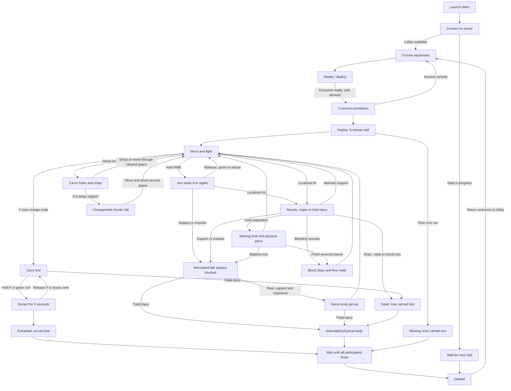

# Game State

TK is a playable, server-authoritative extraction-shooter super alpha. Play solo against two sentries or join the same server with other clients. Choose equipment, ready up, collect loot, survive, and hold the extraction interaction to secure your haul.

## Player flow



## Run a local playtest

Use the repository's Rust nightly toolchain and a GPU supported by Bevy 0.20. From the repository root, start the server in one terminal:

```sh
cargo run --bin server
```

In a second terminal, also from the repository root:

```powershell
cargo run --bin client
```

The client defaults to `127.0.0.1`, UDP port `9080`. No `.env` file is needed, and assets are resolved from the client manifest directory rather than the shell's working directory. For LAN play, set `$env:SERVER_ADDR = "192.168.1.10"` to your server's IP before starting the client (POSIX: `SERVER_ADDR=192.168.1.10 cargo run --bin client`). Allow the server's UDP port through the firewall. Optional `TK_PORT` changes the port on both binaries.

Rebuild both binaries for protocol 28. The client waits for referenced configurations before presenting a snapshot; delayed configuration retains the last accepted world until the normal stale timeout. Close an older server before launching the current build on the same port; the automated harness does not stop a player's existing server.

For private QA only, start the server with `TK_FIXTURE_ACTION_FAULT=1`. The first otherwise-available primary action per issued instance is blocked without spending ammo. **R** starts generic recovery; aiming, sprinting, trying to fire, or changing slots interrupts it. The HUD reflects only confirmed state. Ordinary runs leave this fixture off.

Start additional clients in separate terminals to test multiplayer. All connected players must ready up; solo play also starts normally. The server supports up to 32 clients and assigns distinct spawn positions. A client arriving during an active raid waits for the next lobby.

### First complete raid

1. In the lobby, use the kit buttons to choose equipment, then activate **Ready / deploy**. Use **Cancel ready** to cancel before deployment. Gear is locked while ready or awaiting confirmation.
2. After the three-second countdown, you spawn at approximately `x 0 / z 10`, looking toward negative Z. Find an **orange crate**; the nearest is at `x -4 / z 0`. Walk near it and press **F** to pick up one loot unit. A looted crate becomes gray for everyone and remains solid cover.

   Six voxel loot stacks sit beside the crates. The bandage stack contains two units and can be split and merged in the backpack grid. Look at a stack within 2.25 m with a clear line of sight and press **F** to collect. The stack stays on the ground if your grid has no space. When the last confirmed backpack layout has no fitting space, the ground-item hint suggests opening the backpack with **Tab** to make room. The hint does not confirm or reject a pickup. Loot still in your grid counts toward extraction by unit, as does loot from the crates.
3. Two **red sentries** guard the yard. Shoot them or use cover. Brown panels and crates are penetrable wood; gray structures are bullet-stopping concrete. Shots break cells out of the wood panels and interior concrete cover. Other players can also hurt you.
4. Return to the **green exit**, centered at `x 0 / z 15`. The HUD shows your position and distance to the exit. Bring at least one loot unit and hold **F** continuously for five seconds inside the green circle. Releasing F or leaving the zone resets progress.
5. The result becomes **Extracted** and your loot is added to **Secured this session** exactly once. If other participants are still playing, wait for them to finish. In **Debrief**, activate **Return everyone to lobby**, then ready up for another raid.

There is no respawn during a raid. Destroyed head/thorax tissue, a destroyed brain, severe blood loss or the five-minute timeout loses carried loot. Secured loot lasts for the current connection/server session.

The combat HUD shows the sum of regional HP and up to three injuries, ordered
by lowest remaining fraction. Blood loss and life-threatening conditions are
separate from HP. Chamber state and inserted-magazine rounds follow the active
weapon; an absent magazine is distinct from an empty one.

### Arena Solo

With one connected player, select **Mode: Arena Solo** in kit preparation.
Use the same workbench and **Ready / deploy** button. The server spawns one bot
and runs a continuous duel, without raid loot or extraction. Either combatant
returns after three seconds when a spawn is clear. Use **Leave Arena / return
to lobby** from the pause or respawn menu, then ready again or switch to Raid.
To verify the simulated duel over local UDP with a rendered client, run
`python scripts/playtest.py --arena-solo`. This route drives ordinary client
inputs; it does not replace testing the menu with mouse and keyboard.

For **Arena PvP 1v1**, two clients select the same mode and ready up. There are
no bots. Other clients wait for the next lobby. Leaving or disconnecting returns
the other combatant to the lobby, where a new pair can prepare another duel.

## Controls

| Input | Action |
| --- | --- |
| Click or Tab / arrows, Enter / Space | Activate a menu button; Tab / arrows move the outlined focus (Shift+Tab goes backward) |
| V | Optional shortcut to open/close the weapon workbench in the lobby |
| W, A, S, D | Move |
| Mouse | Look |
| Left Shift / Left Ctrl | Run / crouch |
| Z | Toggle prone; remap to an unused letter with `TK_PRONE_KEY` (e.g. `X`); invalid or reserved letters fall back to Z |
| Space | Jump while active; never respawn during the current raid |
| Hold Q / E | Gradually lean left / right; release both keys (or hold both) to return to neutral |
| 1 / 2 | Equip your selected primary / pistol |
| Left mouse button | Hold for rifle/SMG automatic fire; click for pistol semi-automatic fire |
| Hold right mouse button | Aim down iron sights; release to return to hip fire |
| R (default) | Swap to a retained loaded magazine; feed an empty chamber |
| B | Cycle Safe/Semi/Auto as supported by the weapon |
| I | Inspect; yields to fire, ADS, reload, sprint or weapon switch |
| F | Collect nearby loot; hold in the exit to extract |
| Tab / Up / Down / Delete | Open raid inventory, select an item, and request a drop; Tab or Esc closes the panel |
| Inventory: drag, or Enter / arrows / Enter | Move an item within the backpack grid; **R** rotates the preview and Esc cancels it. Releasing outside the grid cancels without dropping anything. The grid follows server confirmations |
| Inventory: Shift+drag or Shift+Enter | Use left/right to adjust split quantity, Tab/Shift+Tab to focus a control, and Enter to activate it (Choose is focused by default). Choose the quantity, then select an empty destination. Esc cancels the split. Drop a normal drag onto a compatible stack to merge; excess stays in the source |
| Inventory: right-click or Menu / F10 | Open the item's Inspect / Drop menu. Use mouse or arrows / Tab / Shift+Tab and Enter. Esc closes the menu before cancelling a drag or closing the inventory |
| I in raid inventory | Hold the selected item up for local inspection. Arrow keys rotate, +/- change viewing distance, R resets, and I or Esc returns to the list |
| Escape | Close the workbench, inspection or inventory first, or toggle the local pause menu during a raid. Pausing releases the cursor and suppresses local actions; the server and dangers continue |
| Up / Down arrow | Narrow / widen the field of view |
| F8 / F9 | Toggle weapon socket/pivot debug overlay / cycle inspection LOD while enabled |

Hover a backpack item to see its confirmed quantity and condition. Move, split,
and merge play a short cue after confirmation or explicit rejection unless game
audio is muted. A drop request does not play a confirmation cue.

For less first-person camera movement, launch the client with
`TK_CAMERA_BOB=reduced` or `TK_CAMERA_BOB=off`. This changes only the
cosmetic step motion, not stance, mouse aim, or collision.

Open **Preferences** from an unready lobby or the local pause menu to change
vertical FOV, mouse sensitivity, UI scale (100% or 125%), or the reload key
(**R**, **[**, or **]**). Volume changes apply to newly played sounds.
**Apply and save** writes the choices to `~/.config/tk/preferences.json`
(or `$XDG_CONFIG_HOME/tk/preferences.json`; `TK_PREFERENCES_PATH` overrides the
file path). **Revert** restores the last applied choices in the draft;
**Use defaults** fills the draft without applying it. Back or Esc discards
unapplied edits.

Sprint straight into a low blocking obstacle and the character briefly
stumbles. Walking, climbing a passable step or running into a high wall
does not trigger it. Holding against the same obstacle won't restart the
reaction. Compare the west training lanes at `x -14` (step) and `x -16`
(low block), both near `z 2`.

Inspect now presents both sides of the equipped assembly while preserving its
ammunition and grips. Equip/unequip presentation follows the server's action
clock and slot marker. Hip/inspect framing uses the actual configured bounds
without changing FOV. In-game handling review remains pending; see the
[handling contract](weapons/handling.md).

### Configure a weapon

In the lobby, activate **Weapon workbench**. Choose primary or sidearm, edit the
draft and activate **Apply**. The preview shows compatible changes immediately,
without equipping them. Click a numbered socket in the 3D preview to focus its
row, or use Tab/arrows to move focus in the list; activate the row to cycle options.
The preview labels draft, submitted and confirmed assemblies separately.
Invalid drafts show the resolver's dependency/interface/clearance reason and
display the confirmed assembly instead.
Removing an optional parent also removes its draft descendants; Apply commits
the whole selection atomically. **Discard draft** restores the confirmed kit.
Use **Back to lobby** or Esc to close the workbench and restore focus to its
lobby button. Ready/countdown/raid lock edits; a pending kit confirmation also
blocks readiness and equipment changes. Countdown closes the workbench and
prevents reopening it, keeping **Cancel ready** available in the lobby.

For a compact M4A1, select PMAG20, CTR position0, MOE SL, DD10.3 and A2.
For a suppressed M4A1, select magazine30, CTR position5, RAS, FN14.5, SFMB,
RC2, QRP2 position3, PRO and RVG position9. The three reserve rows can hold
20/30-round magazines or None; sidearm reserves remain separate.
The confirmed selection survives extraction/debrief and is restocked with new
owned equipment for the next raid. This is free raid gear, not a stash or shop.

## Gameplay

- **Equipment and weapons.** Every loadout has a rifle or SMG plus a pistol. Each weapon owns its inserted magazine and up to three selected reserves. Default capacities are 30/25/17; M4A1 also supports PMAG20 and mixed 20/30 reserves. Initial loaded count includes one real chamber round transferred from the inserted magazine. The HUD distinguishes chamber, inserted-magazine count/absence and rounds in retained magazines. Tactical reload retains the old magazine and chamber; a full replacement can produce capacity +1 without granting ammunition. Empty reload must insert and feed before firing. Baseline reload takes 2.4/1.9/1.5 mechanical seconds; arm injury slows the shared action clock. Switching cancels unfinished work but keeps committed magazine/chamber state, then takes 0.2 s to holster and 0.35 s to equip before firing. Death, fall, trigger-arm loss and stale input cancel actions. Inspect changes no ammunition. Empty weapons do not auto-reload. Gear is free and restocked for each new raid.
- **Weapon presentation (in progress).** Both perspectives use original stepped M1911, MP5 and M4A1 assemblies and shared grip/muzzle/action anchors. The models were accepted as a first delivery, but the user requested further movement/reload/FOV polish; this is not final artistic acceptance. The rifle is displayed as **M4A1** in the lobby and HUD, with base identity `m4a1`; Pistol/SMG remain class labels. The [weapon reference contract](WEAPON_REFERENCES.md) selects the real 14.5-inch M4A1 and Colt Government .45 ACP targets. Current geometry and gameplay are still provisional: the pistol retains its 17-round baseline until the dedicated M1911 fidelity slice. Empty M1911 reloads include an overhand slide release; the MP5 handle retracts/locks and is slapped forward; the M4A1 uses its visible bolt catch. Tactical reload animations do not rack the action; both variants now read explicit authoritative mechanical state, with a separate chamber. A removed magazine stays absent after interruption. Inspect currently exposes its action in the HUD; detailed handling poses remain in progress. The MP5 handle does not reciprocate on fire. Swaps/interruption blend from the displayed pose. Confirmed shots eject procedural brass casings sized by weapon class; they tumble/bounce, remain for 60 seconds, and have no active-count cap. Reduced step cadence, centimetre-scale bob and measured turn-rate sway replace rapid oscillation and snapshot pulses. World FOV defaults to 70 vertical degrees and supports 20–160; the weapon projection stays at 65 degrees rather than changing with world zoom. Arrow-key adjustment is time-based. First-person pistol reload cant pivots about the receiver, and its weapon/gloves/visible magazine fit the final viewport without changing the lens; sleeves remain attached and ADS stays centred. The framing correction eases away during deliberate lowering. Candidate17's inspected native reload frames no longer show16's right-edge pistol crop; normal-speed review and final artistic acceptance remain pending.
- **Authoritative recoil.** Every accepted shot advances the server-owned recoil response; mouse input remains voluntary aim. Mass, balance and explicit configuration modifiers change angular kick and recovery. Clients smoothly display the replicated response without feeding it back as extra input or merging several shots into one angular impulse. See [recoil units, bounds and network behavior](weapons/recoil.md). This changes the baseline handling of all three platforms; native motion acceptance is in progress.
- **M4A1 asset refinement.** Both perspectives now use the dimensioned breech-root M4A1 and 30-round magazine. Shared authored sockets provide grips, sights, physical bore, device outlet and moving controls. The carrier moves independently of the charging handle and remains open when the authoritative bolt is open. ADS uses the authored eye frame, with the rear sight beyond the camera's near plane. Hip framing places the upper arms below the weapon, using stock-relative shoulders and rigid hand contacts. Forward assist, magazine release, pins and bolt-catch serrations are distinct external details. Static shape and near/far LOD review passed in both perspectives; see [asset evidence and costs](weapons/m4a1-asset.md). Reload/inspect polish and the modular-weapon slice gate remain separate work.
- **M4A1 modular kit.** The base now assembles separate receiver, stock, RAS, barrel, irons and muzzle device. The [kit reference](weapons/m4a1-kit.md) documents PMAG20, CTR, MOE SL, DD10.3, SFMB/RC2, PRO/QRP2 and RVG/AFG-2 alternatives. Installed parts determine capacity, mass and contacts; incompatible interfaces, overlapping rail footprints and clearance conflicts are rejected. The lobby configurator selects this kit through versioned server commands. Collapsed-stock ADS frames the complete solved rig to preserve the rear sight and rigid contacts.
- **M4A1 projectile origin and ADS zero.** Flight starts at the authored device outlet, and the server checks anatomy and cover along the full eye-to-outlet path. Fully settled ADS uses a 20 m arena reference from the eye. The correction follows the installed kit and the catalogued projectile speed; Ball and AP currently share that speed. At 2 m the compact iron-sight and suppressed red-dot test kits still impact below the sight line. Hip aim, damage and camera projections are unchanged.
- **M4A1 reload refinement.** Mixed 20/30-round pools display the physical outgoing/incoming magazine, including its grasp geometry before insertion. The hand clears the magwell during approach and changes finger pose for magazine retention and bolt-catch press. Insertion/feed follow authoritative commits; switching preserves the lowering weapon's own magazine state. [Reload contracts and geometric checks](weapons/reload.md) cover both perspectives. Native network execution passed; normal-speed artistic acceptance and the rendered 30/60/165 FPS matrix remain pending.
- **Aim down sights.** Hold **RMB** to raise the current weapon onto its actual iron sights, ease world zoom to 52 degrees for the pistol or 44 for primaries, hide the centre dot and reduce weapon bob/mouse sensitivity. Release to ease back to the selected FOV. Sprinting, reload, fall, death or loss of captured active input lowers the sights, including the support-controller fallback at the physical-piece budget. The server replicates aim, centres the aimed barrel on the weapon's shared sight placement and retains cover obstruction checks. ADS changes no ammunition, damage, cadence or reload duration and grants no spread bonus.
- **Ammo and penetration.** Ball is the default. AP has 1.8 times the penetration and 85% of the damage. Projectiles travel from the offset barrel, drop under gravity, and use continuous map ray casts plus posed anatomical boxes. At point blank, the server first resolves actual body/cover between eye and muzzle, then continues the unchanged muzzle ray if clear; the broad movement capsule no longer shifts an offset-aimed shot back to the eye. A ray between limbs continues to the map or another actor. Wood costs 20 penetration units per metre, once per surface across clearance and flight; concrete stops rounds. A barrel pushed through cover or a nearby body cannot bypass it. Impact marks are smaller and weapon-sized: 25 mm for pistol, 35 mm for SMG, and 50 mm for rifle. Shots are temporarily **silent**, including sentries. Confirmed shots retain flash, damped weapon recoil, bolt motion, tracers and impact marks; rejected triggers produce none of that firing feedback. The red laser remains cosmetic.
- **Body damage and armor.** Live anatomy has head (35), thorax (85), abdomen (65), separate left/right arms (60 each) and separate left/right legs (70 each). Muscle strength is regional. Leg injury reduces speed/jump and changes that side's gait; further injury never restores speed. Arm injury slows reload and increases weapon sway. Losing the trigger arm disables firing/reload and hides the unusable view weapon; an absent support hand disappears from the first-person view. Vests cover the thorax and helmets cover the head. Armor resolves once per impact: stopped rounds apply 20% blunt tissue damage without internal injury; penetrating armored hits apply 80%, with 40% raw-damage durability wear. Worn armor protects less. Brain destruction kills immediately; heart damage accelerates blood loss, liver injury adds bleeding, and stomach injury worsens vigor use/recovery. The HUD shows lateral capacity, blood loss, vigor, region/organ and physical mode.
- **Articulation and physical state.** Players and sentries share 17 posed anatomical segment IDs. Voxel clothing, gloves, boots, equipment and damaged interior layers follow that rig. Crouch bends the joints instead of scaling the actor. Authoritative world-space stance contacts keep feet planted through starts, brakes and turns, including floor/step probes; acceleration and turn rate drive weight transfer. Living falls use articulated Rapier bodies inherited from the current pose and individual segment velocities. Firing/reload stay blocked until rest, ground support and standing clearance permit a one-second same-body get-up. Death during fall/get-up retains the existing segment IDs and resumes dynamics. Packed actual poses align authoritative damage volumes; separation detaches existing pieces rather than duplicating them. Death from standing also transfers per-segment movement and localized impulse/torque. Knees use anatomical limits, not extra flexion on top of the captured bend. Non-adjacent contacts and six additional solver iterations stabilize the new slower-stride fall poses. The server caps pieces at 320; living attached pieces keep their lifetime, while dead/detached pieces expire after 35 seconds and raid changes clear them. At the saturated budget, the support-controller fall remains a fallback. Roots/pieces interpolate and new visuals begin at the displayed live silhouette. Persistent state reconstructs wounds/absent segments after loss; shot IDs suppress duplicate feedback. Protocol is **15**, including [reload magazine identity](weapons/reload.md), so rebuild both binaries together. The earlier protocol-4 dual/matrix evidence does not certify the new ADS/cadence revision.
- **Blood and gore.** New bullet wounds spray red voxel droplets; dismemberment produces a larger burst at the stump. Bleeding players (including your own body) and sentries drip blood, and fresh detached limbs leave short blood trails. Droplets fall into red floor stains. These are cosmetic effects driven by server anatomy, with bounded counts and lifetimes; they do not change injury or blood-loss rules. Effects reset between raids. No fluid simulation or wall splashes. Rendered appearance remains unreviewed.
- **Destructible cover.** Shots carve small openings into the two brown panels and chip the interior gray cover. Nominal bores are 6 mm for rifle, 9 mm for SMG and 11 mm for pistol. Wood sections have 160 structural HP; concrete sections have 100 HP. A wood bore leaves surrounding cover and movement collision intact; later shots can pass through the opening. Concrete retains material behind a shallow chip and stops the impacting shot, including the shot that breaks its section. Wood still consumes penetration energy when struck. Impact quads do not span new openings, and section-bound marks disappear with their support. Destruction geometry uses the same remaining solids for server collision and client meshes. Full cover refreshes recover loss/late arrival without growing actor snapshots. Cover restores between raids. The floor, perimeter walls and loot crates remain intact. Severing a section's floor-connected support releases neighboring unsupported sections into server gravity. Failed sections crumble into smaller chunks; unsupported neighbors keep their remaining shape. Rubble collides with the map and other rubble, retains wood/concrete bullet behavior, and leaves no floating impact quads. It does not damage players or become controller support. At most 64 chunks are kept; older chunks are removed first at the cap and all expire within 20 seconds. Full destruction state includes chunk IDs, poses and scales; clients interpolate poses. Raid reset clears cuts and rubble and restores all cover. This is a bounded, stepped fracture approximation, with nominal axis-aligned bores, rather than a material/structural engineering simulation.
- **World and enemies.** The bounded yard has three shared loot crates, wood panels, concrete cover, and one green extraction circle. Rendering and server collision use the same map definition. Two stationary sentries fire pistols when a living participant is visible within 18 metres. They use the same projectile, damage, armor, reload, and ammo rules as players.
- **Authority and feedback.** Only the server decides equipment, hits, loot availability, extraction, and results. Simulation runs at 128 Hz and snapshots are sent at about 60 Hz. The HUD shows phase/time, weapon, magazine/reserve/reload, health, armor, loot and extraction progress. A top-right overlay shows smoothed client FPS and frame interval in milliseconds; it does not report GPU render time. Stale movement/fire/interaction is neutralized after 0.5 seconds without input. Transport errors no longer crash the game; the HUD reports stale/disconnected state.

## Automated playtest and evidence

### Fast engine-only checks

Physics and authoritative gameplay can be tested without opening the game. The fixtures in `server/src/tick/tests.rs` run the real Bevy/Rapier systems with `MinimalPlugins` and a manual 1/128-second timestep, advancing simulation as fast as the CPU allows without rendering, a GPU context, real-time waits or a listening UDP socket. From the root:

```sh
python scripts/verify.py --package server --filter real_rapier
python scripts/verify.py --package server --filter ragdoll_running_and_resting_contact_matrix
python scripts/verify.py
```

Use a focused test during physics iteration, then the broader suite; the first build can still take time. `python scripts/verify.py --mode full` adds workspace formatting/check/Clippy/tests, without starting an application; `--mode docs` is the Cargo-free path for documentation-only edits. These checks validate engine/tooling state, not visible animation, camera framing, interpolation or real network delivery. `AGENTS.md` summarizes setup, verification and contribution rules; local skills provide detailed workflows.

### Rendered end-to-end acceptance

When the change requires visible or real-network acceptance, run the relevant harness after headless checks, not on every solver iteration. From the root:

```sh
cargo check --workspace
cargo test --workspace -j 4
python scripts/playtest.py
```

The harness builds isolated executable outputs (so it does not replace a running player's Windows executable), starts its own server on UDP `19080`, and drives normal network input through equipment, deployment, loot, sentry combat, extraction, debrief, lobby and second deployment. It does not teleport the player, override damage, accelerate time or grant rewards. `python scripts/playtest.py --clients 2 --output target/playtest/dual` launches two rendered UDP clients; the peer selects an SMG and deliberately discards every third snapshot. Do not run harness instances on the same port concurrently. Runtime logs include server tick/snapshot and client frame measurements.

Logs, `result.txt`, and actual 1280×800 screenshots (`lobby.png`, `raid.png`, `extracting.png`, `debrief.png`, `return-lobby.png`) are written to `target/playtest/`. Use `--no-build` after a successful `cargo build --workspace`; `--output PATH` chooses another evidence directory. Screenshots from earlier runs cannot satisfy a new run's checks. A successful run prints `PASS`; failures return a nonzero exit code.

Video is **off by default**: do not add `--video` for physics tests or ordinary rendered acceptance. Use assertions/logs for simulation and only the necessary screenshots for static visual checks; record video only on explicit request or for a visual/temporal criterion that requires continuous evidence. When required, add `--video` and use a fresh output directory. This records real framebuffer PNGs plus `frame-times.csv`, then uses `imageio-ffmpeg` to encode `raid-review.mp4` for each client without inventing intermediate gameplay frames. Keep the PNGs for adjacent-frame inspection. `--clients 2 --animation-review` adds a reciprocal continuous M1911/primary handling route through ordinary UDP inputs before the normal extraction run. Recording has measurable capture/encoding overhead; measure ordinary performance without capture, and compare capture runs only with equivalent settings. Animation and ragdoll polish is currently in progress, not accepted as production-quality art.

The optional video/frame-index/performance helpers use Python3.12+; video encoding needs `imageio-ffmpeg` and contact sheets need `Pillow` in your Python environment (for example, install them in a virtual environment). The ordinary no-video raid runner uses the standard library. No helper installs global packages automatically.

For the full physical-humanoid suite, run `python scripts/validate_humanoids.py`; it runs formatting/check/tests, bounded physics/snapshot tests, a normal raid and two real UDP clients without changing source between gates. The dual scenario additionally captures directional poses, weapon cycles, lateral injuries, balance correction, fall/recovery, separation and ragdoll. See [PHYSICAL_HUMANOIDS.md](PHYSICAL_HUMANOIDS.md) for the seven-criterion evidence index, before/after measurements and manual anatomical shot placement. Tests use normal network input; the remote review camera hides only its local view-model overlay, not actors or simulation.

The ongoing polish evidence is indexed in [ANIMATION_RAGDOLL.md](ANIMATION_RAGDOLL.md). For an explicitly required continuous visual review, `python scripts/review_animation_frames.py PATH` indexes all 17 action timestamps and adjacent native frames from existing recordings of both the acting and observing clients. `python scripts/playtest_physical.py --server-path PATH --client-path PATH --output PATH` runs healthy rest/run deaths on flat ground and near a wall on isolated UDP 19081 without video; it still launches rendered clients and checks 17 segment IDs and resting position/orientation agreement under peer snapshot loss. Use the headless engine matrix instead for solver iteration. This focused network matrix does not replace the normal loot/extraction acceptance. Failing baseline cases stay failures even when `--keep-going` retains their evidence.

## Playtest limitations

- This is a primitive local/LAN alpha: no accounts, public matchmaking, production authentication or anticheat. Netcode is deliberately unsecure. Do not expose it as a public service.
- Equipment customization means primary/ammo/vest/helmet choices, not attachments, clothing or a grid inventory. Loot is a counter, not individual items. No stash/economy is saved to disk; disconnecting loses that client's secured total.
- There is one map, one exit, a fixed three-second countdown, a five-minute raid and a five-second extraction hold. Empty-handed extraction is disallowed. No healing, mobile AI or imported/final art. Procedural voxel art and animation are alpha-quality; the recorded native review is reproducible, not a claim of final production art.
- Multiplayer has friendly fire and no teams. Local movement and both first-person cameras interpolate confirmed server positions every render frame with a 50 ms presentation buffer; mouse look stays immediate. The 60 Hz snapshot trial halves the previous 100 ms buffer; interpolation avoids a snapshot-paced position staircase but still adds movement display latency. Snapshot payload traffic is roughly twice the previous 30 Hz rate. Deployment, physical-mode changes, large corrections and recovery from stale snapshots reset the buffer; an outage holds the last confirmed position. Remote presentation also interpolates. Local motion has no prediction and there is no lag compensation. A remote LAN host is not separately tested.
- During a surviving physical fall/get-up, the local head camera hides its own attached body meshes to prevent camera/torso clipping; other clients still see the entire physical body and detached pieces stay visible. Death hides the active body/weapon and shows the authoritative physical body until its lifetime expires. There is no spectator camera or early return while another participant is active; wait for debrief, or reconnect.
- The client connects at launch. **Cancel connection** stops an attempt or leaves a stale connection; **Disconnect from server** leaves the current session without closing the client. **Reconnect** creates a fresh session at the configured address and keeps local preferences. It does not restore inventory or secured loot from the previous session. Graphics/audio need a suitable local device; the automated run uses the same graphics stack as normal play.

## Visual and gameplay tuning

**POV correction review.** On 2026-11-21, checked pistol forearm extension in hip fire and ADS across portrait to ultrawide, and actual rifle receiver/action/sight vertices through maximum recoil at upward, level and downward aim. Full workspace checks passed with 292 Rust tests and 41 Python checks; one real UDP test remains opt-in. Rendered acceptance is pending, and gameplay flow is unchanged.

- **Configured weapons.** Both perspectives assemble the accepted weapon configuration from shared baked parts. Reload hands follow moving magazine/control sockets; remote anatomical arms and first-person arms use the same rigid-length IK solver. First-person pistol shoulders sit behind and below the grips so the forearms extend toward the weapon; framing translates the complete rig while preserving ADS centring. Rifle framing keeps the receiver, sights and moving mechanisms ahead of the camera near plane during recoil, while allowing the stock behind the eye. These two corrections have headless geometry coverage; rendered acceptance remains pending. Primary ADS turns the upper-body stance before bringing the stock onto the shoulder pocket, accounting for light/heavy armor; the view-model retains its explicit camera-space shoulder frame and baseline sight alignment. Missing limbs keep their visibility rules, and fall/recovery or a disabled trigger arm hides the weapon. Server damage and physical handoff use the accepted configured anatomy; unreachable updates retain the accepted local pose as the actor moves. Baseline assembly/contact integration passed local/remote rendered review; refined assets and authored inspect/handling remain slice work.
- `common/src/humanoid.rs`: stable segment IDs, dimensions, joint poses, directional stride and posed ray boxes. Keep render and damage IDs together when changing proportions.
- `common/src/combat/anatomy.rs`: regional maxima, separation threshold, organ volumes, blood thresholds, bleeding and vigor. `common/src/combat.rs` owns armor and Arsenal cadence/reload.
- `server/src/tick/physical.rs`: support/impulse thresholds, recovery clearance, ragdoll limits/damping, piece cap/lifetime. The server remains headless at 128 Hz with approximately 60 Hz snapshots.
- `server/src/tick/locomotion.rs` and `server/src/tick/ragdoll.rs`: planted world contacts, inertial gait inputs, per-segment motion capture and localized impulse/inertia transfer.
- Stationary large turns release/replant one foot at a time instead of leaving the legs crossed; loose body fragments do not become controller ground support or autosteps.
- `server/src/tick/live_body.rs`: surviving physical falls, support/clearance checks, same-ID get-up and actual-rig readback.
- `client/src/render/actors.rs`: cached original voxel meshes/materials, carved damaged shells, interior/organ layers, equipment and world weapons. Replace meshes here without replacing shared anatomical IDs or creating a mesh per actor/frame.
- `client/src/render/feedback.rs`: per-weapon recoil impulse, spring/damping, flash lifetime, reload/swap and camera feedback.
- `client/src/render/shot_audio.rs`: original synthesized sounds for confirmed shots, dry-fire acknowledgments and observed handling events, spatial for remote players. Of the 12 concurrent voices, the last two are reserved for handling cues so a burst cannot claim every slot. Cues dropped at capacity are not replayed. The confirmed shot's configuration affects loudness and the attenuated profile softens the transient. Set `TK_MUTE_AUDIO=1` to mute; automated playtests are muted by default. The legacy files in `assets/sound/` are not loaded.
- `common/src/weapon_animation.rs` and `client/src/render/weapons.rs`: original grip/muzzle anchors, per-weapon empty/tactical choreography, and cached first-person weapon assemblies; curves do not grant ammo or actions.

**Configured assembly review.** On 2026-11-15, configured assembly passed 225 Rust tests and 26 Python tooling tests, plus the full fmt/check/Clippy gate and workspace build. Native dual-client acceptance passed with real UDP and every third peer snapshot dropped: three baseline weapons, ADS/reloads, loot/extraction/redeploy, ordinary limb shots, separation, recovery and ragdoll. Both clients converged on final anatomy and 17 physical piece IDs; live recovery retained its 15 remaining body IDs. Local/remote screenshots were inspected, including a repeat with the verbose review HUD hidden and front/side observer framing. Geometric fixtures additionally measure rigid arm lengths, actual moving sockets, stock/cover surfaces, replacement stability and rejection. This verifies assembly/contact integration, not final artistic or performance acceptance.

**Protocol review.** On 2026-11-15, integrated protocol 11 reliable versioned weapon configuration, compact snapshot references and client waiting for unknown configurations. Shots exceeding the snapshot budget travel reliably; gap-aware deduplication and a late-join baseline prevent replay. Headless endpoint/Renet checks cover delayed configuration, overflow, queue pressure and duplicate commands. Native UDP solo→dual/late-join gates passed both without loss and with 20% datagram loss in each direction, reconstructing the tactical reload's magazine-removal commit. Rendered acceptance was not run for that revision.

**Snapshot review.** On 2026-11-15, reviewed the 60 Hz snapshot trial and 50 ms local camera buffer using headless serialized-network cadence and 60/165 FPS trajectory tests with jitter/loss; gameplay flow and the Mermaid diagram are unchanged, and visible smoothness and real UDP delivery remain unverified.

**Cover review before integration.** On 2026-11-15, reviewed sparse bullet damage through authoritative same-tick shots, shared collision/render geometry, surface-bound marks, late-join state and protocol-9 loopback UDP; headless workspace tests passed, and the gameplay diagram will be updated with falling rubble in the final destruction step.

**Latest review.** On 2026-11-16, reviewed the integrated 60 Hz/50 ms camera path, configured-weapon replication and physical cover destruction. The full formatting/check/Clippy gate passed with 286 Rust tests and 41 Python checks. Engine fixtures cover small bores, same-tick penetration, concrete/rubble backstops, support loss, floor contact/settling, body and geometry limits, expiry, late join and raid reset. Client tests check real mesh openings, chunk identity/interpolation/scale and mesh cleanup. Protocol15 uses independent configuration/shot/cover channels; prior integration UDP checks passed both without loss and with 20% datagram loss, and the final 5,944-byte cover check and unchanged weapon loss test passed. Independent review accepted all six engineering criteria, with 23 focused cases and 3/3 isolated faults detected. The Mermaid now includes support loss and falling chunks. No new rendered or artistic acceptance is claimed.
