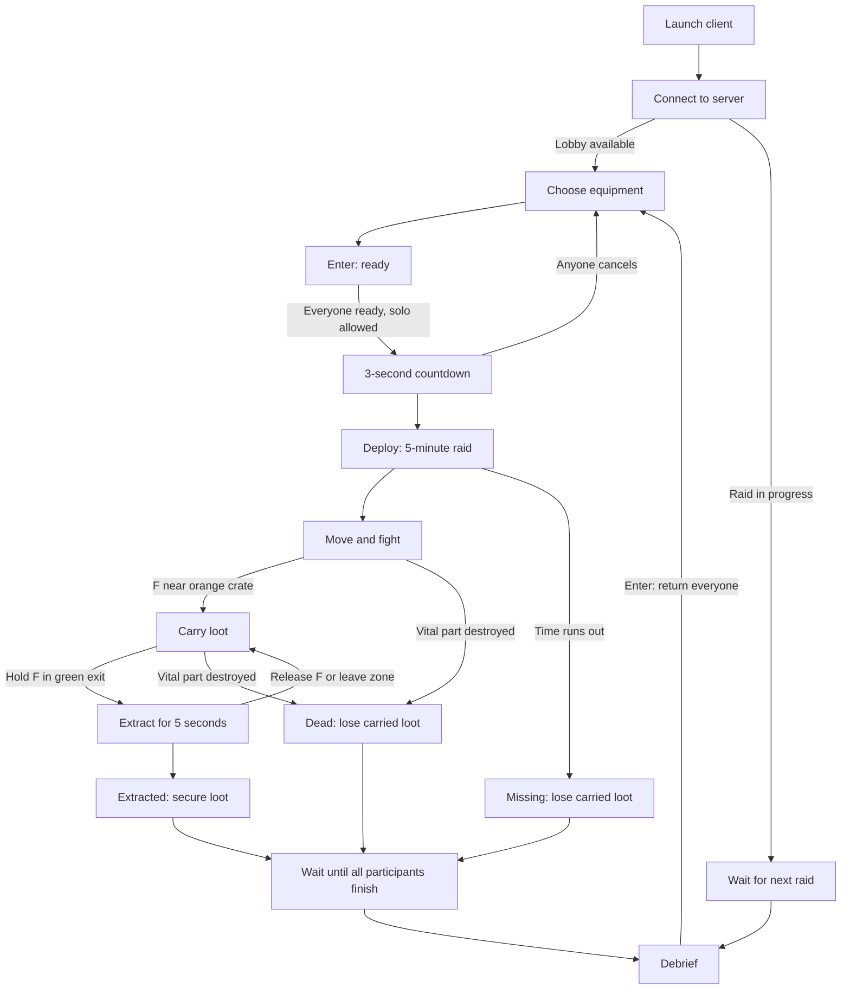

# Game State

TK is a playable, server-authoritative extraction-shooter super alpha. Play solo against two sentries or join the same server with other clients. Choose equipment, ready up, collect loot, survive, and hold the extraction interaction to secure your haul.

## Player flow



## Run a local playtest

Use the repository's Rust nightly toolchain and a GPU supported by Bevy 0.20. From the repository root, start the server in one terminal:

```sh
cargo run --bin server
```

In a second terminal, also from the repository root:

```powershell
cargo run --bin client
```

The client defaults to `127.0.0.1`, UDP port `9080`. No `.env` file is needed, and assets are resolved from the client manifest directory rather than the shell's working directory. For LAN play, set `$env:SERVER_ADDR = "192.168.1.10"` to your server's IP before starting the client (POSIX: `SERVER_ADDR=192.168.1.10 cargo run --bin client`). Allow the server's UDP port through the firewall. Optional `TK_PORT` changes the port on both binaries.

Start additional clients in separate terminals to test multiplayer. All connected players must ready up; solo play also starts normally. The server supports up to 32 clients and assigns distinct spawn positions. A client arriving during an active raid waits for the next lobby.

### First complete raid

1. In the lobby, choose your equipment with **G/B/H/J**, then press **Enter**. Gear is locked while ready. Press Enter again during the countdown to cancel readiness.
2. After the three-second countdown, you spawn at approximately `x 0 / z 10`, looking toward negative Z. Find an **orange crate**; the nearest is at `x -4 / z 0`. Walk near it and press **F** to pick up one loot unit. A looted crate becomes gray for everyone and remains solid cover.
3. Two **red sentries** guard the yard. Shoot them or use cover. Brown panels and crates are penetrable wood; gray structures are bullet-stopping concrete. Other players can also hurt you.
4. Return to the **green exit**, centered at `x 0 / z 15`. The HUD shows your position and distance to the exit. Bring at least one loot unit and hold **F** continuously for five seconds inside the green circle. Releasing F or leaving the zone resets progress.
5. The result becomes **Extracted** and your loot is added to **Secured this session** exactly once. If other participants are still playing, wait for them to finish. In **Debrief**, press **Enter** to return everyone to the lobby, then ready up for another raid.

There is no respawn during a raid. If your head or thorax is destroyed, or the five-minute timer runs out, carried loot is lost. Secured loot from earlier raids survives these failures but only lasts for the current connection/server session.

## Controls

| Input | Action |
| --- | --- |
| Enter | Toggle readiness in lobby/countdown; return everyone to lobby from debrief |
| G / B | In an unready lobby, choose rifle or SMG primary / Ball or AP ammo |
| H / J | In an unready lobby, cycle no/light/heavy vest / toggle helmet |
| W, A, S, D | Move |
| Mouse | Look |
| Left Shift / Left Ctrl | Run / crouch |
| Space | Jump while active; never respawn during the current raid |
| Q / E | Tilt the view left / right |
| 1 / 2 | Equip your selected primary / pistol |
| Left mouse button | Hold for rifle/SMG automatic fire; click for pistol semi-automatic fire |
| R | Manually reload the selected weapon from finite reserve ammo |
| F | Collect nearby loot; hold in the exit to extract |
| Escape | Release or recapture the cursor during a raid; lobby/debrief release it automatically |
| Up / Down arrow | Narrow / widen the field of view |

## Gameplay

- **Equipment and weapons.** Every loadout has a rifle or SMG plus a pistol. Magazines hold 30/25/17 rounds respectively, with three additional magazine-equivalents in reserve for each equipped weapon. Reload takes 2.4/1.9/1.5 seconds. Switching weapons cancels an unfinished reload. Empty weapons do not auto-reload. Gear is free and restocked for each new raid.
- **Ammo and penetration.** Ball is the default. AP has 1.8 times the penetration and 85% of the damage. Projectiles travel from the barrel, drop under gravity, and use continuous Rapier ray casts. Wood costs 20 penetration units per metre of thickness; a shot continues only with positive energy and reduced damage. Concrete stops every shot. A barrel pushed through cover cannot bypass that cover. Shots have sound, tracers, and impact marks; the red barrel laser is a cosmetic aiming aid, not a collision preview.
- **Body damage and armor.** Health is localized to head (35), thorax (85), arms (60), and legs (70). Destroying a vital region kills even when other regions have health left. Legs below 35 health reduce movement speed to 55%; excess limb damage spills into the thorax at half damage. Vests cover only the thorax; helmets cover only the head. A stopped round applies 20% blunt damage, a penetrating armored hit applies 80%, and armor loses 40% of the incoming raw damage as durability. Worn armor provides less protection; destroyed armor provides none. The HUD shows all four health pools, armor durability, and the last region hit.
- **World and enemies.** The bounded yard has three shared loot crates, wood panels, concrete cover, and one green extraction circle. Rendering and server collision use the same map definition. Two stationary sentries fire pistols when a living participant is visible within 18 metres. They use the same projectile, damage, armor, reload, and ammo rules as players.
- **Authority and feedback.** Only the server decides equipment, hits, loot availability, extraction, and results. Simulation runs at 128 Hz and snapshots are sent at about 30 Hz. The HUD shows phase/time, weapon, magazine/reserve/reload, health, armor, loot and extraction progress. Stale movement/fire/interaction is neutralized after 0.5 seconds without input. Transport errors no longer crash the game; the HUD reports stale/disconnected state.

## Automated playtest and evidence

From the root:

```sh
cargo check --workspace
cargo test --workspace -j 4
python scripts/playtest.py
```

The harness builds the binaries, starts its own server on UDP `19080`, launches a real rendered client with `--playtest`, and drives normal network input through equipment selection, deployment, loot, a sentry kill, extraction, debrief, return to lobby and a second deployment. It does not teleport the player, override damage, speed up the clock or grant test-only rewards. Do not run two harness instances on the same port at once.

Logs, `result.txt`, and actual 1280×800 screenshots (`lobby.png`, `raid.png`, `extracting.png`, `debrief.png`, `return-lobby.png`) are written to `target/playtest/`. Use `--no-build` after a successful `cargo build --workspace`; `--output PATH` chooses another evidence directory. Screenshots from earlier runs cannot satisfy a new run's checks. A successful run prints `PASS`; failures return a nonzero exit code.

## Playtest limitations

- This is a primitive local/LAN alpha: no accounts, public matchmaking, production authentication or anticheat. Netcode is deliberately unsecure. Do not expose it as a public service.
- Equipment customization means primary/ammo/vest/helmet choices, not attachments, clothing or a grid inventory. Loot is a counter, not individual items. No stash/economy is saved to disk; disconnecting loses that client's secured total.
- There is one map, one exit, a fixed three-second countdown, a five-minute raid timer and a five-second extraction hold. Empty-handed extraction is disallowed. No healing, mobile AI, animations or final art.
- Multiplayer has friendly fire and no teams. Player transforms are authoritative without interpolation, prediction or lag compensation, so latency can make movement look rough. The full native playtest was run locally; a remote LAN host was not separately tested.
- Death/extraction hides the active player/weapon visuals. There is no spectator camera or early return while another participant is still active; wait for debrief (at most the raid timer), or close the client and reconnect.
- The default UI is keyboard-driven and shows all controls. Reconnect currently means restarting the client. Graphics/audio need a suitable local device; the automated run uses the same graphics stack as normal play.

**Latest review.** On 2026-11-14, the guide and unchanged Mermaid flow were rechecked against source, passing domain/ECS tests and another successful native Vulkan/UDP playtest through extraction and a second deployment while organizing the delivery into English Conventional Commits.
