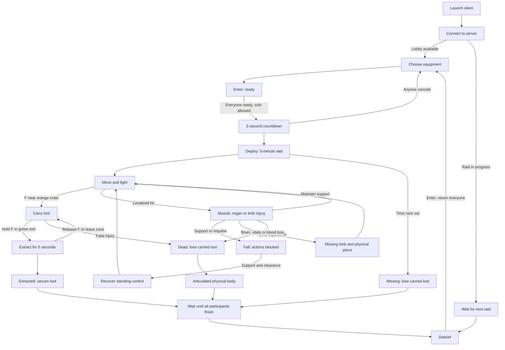

# Game State

TK is a playable, server-authoritative extraction-shooter super alpha. Play solo against two sentries or join the same server with other clients. Choose equipment, ready up, collect loot, survive, and hold the extraction interaction to secure your haul.

## Player flow



## Run a local playtest

Use the repository's Rust nightly toolchain and a GPU supported by Bevy 0.20. From the repository root, start the server in one terminal:

```sh
cargo run --bin server
```

In a second terminal, also from the repository root:

```powershell
cargo run --bin client
```

The client defaults to `127.0.0.1`, UDP port `9080`. No `.env` file is needed, and assets are resolved from the client manifest directory rather than the shell's working directory. For LAN play, set `$env:SERVER_ADDR = "192.168.1.10"` to your server's IP before starting the client (POSIX: `SERVER_ADDR=192.168.1.10 cargo run --bin client`). Allow the server's UDP port through the firewall. Optional `TK_PORT` changes the port on both binaries.

Start additional clients in separate terminals to test multiplayer. All connected players must ready up; solo play also starts normally. The server supports up to 32 clients and assigns distinct spawn positions. A client arriving during an active raid waits for the next lobby.

### First complete raid

1. In the lobby, choose your equipment with **G/B/H/J**, then press **Enter**. Gear is locked while ready. Press Enter again during the countdown to cancel readiness.
2. After the three-second countdown, you spawn at approximately `x 0 / z 10`, looking toward negative Z. Find an **orange crate**; the nearest is at `x -4 / z 0`. Walk near it and press **F** to pick up one loot unit. A looted crate becomes gray for everyone and remains solid cover.
3. Two **red sentries** guard the yard. Shoot them or use cover. Brown panels and crates are penetrable wood; gray structures are bullet-stopping concrete. Other players can also hurt you.
4. Return to the **green exit**, centered at `x 0 / z 15`. The HUD shows your position and distance to the exit. Bring at least one loot unit and hold **F** continuously for five seconds inside the green circle. Releasing F or leaving the zone resets progress.
5. The result becomes **Extracted** and your loot is added to **Secured this session** exactly once. If other participants are still playing, wait for them to finish. In **Debrief**, press **Enter** to return everyone to the lobby, then ready up for another raid.

There is no respawn during a raid. Destroyed head/thorax tissue, a destroyed brain, severe blood loss or the five-minute timeout loses carried loot. Secured loot lasts for the current connection/server session.

## Controls

| Input | Action |
| --- | --- |
| Enter | Toggle readiness in lobby/countdown; return everyone to lobby from debrief |
| G / B | In an unready lobby, choose rifle or SMG primary / Ball or AP ammo |
| H / J | In an unready lobby, cycle no/light/heavy vest / toggle helmet |
| W, A, S, D | Move |
| Mouse | Look |
| Left Shift / Left Ctrl | Run / crouch |
| Space | Jump while active; never respawn during the current raid |
| Q / E | Tilt the view left / right |
| 1 / 2 | Equip your selected primary / pistol |
| Left mouse button | Hold for rifle/SMG automatic fire; click for pistol semi-automatic fire |
| R | Manually reload the selected weapon from finite reserve ammo |
| F | Collect nearby loot; hold in the exit to extract |
| Escape | Release or recapture the cursor during a raid; lobby/debrief release it automatically |
| Up / Down arrow | Narrow / widen the field of view |

## Gameplay

- **Equipment and weapons.** Every loadout has a rifle or SMG plus a pistol. Magazines hold 30/25/17 rounds respectively, with three additional magazine-equivalents in reserve for each equipped weapon. Reload takes 2.4/1.9/1.5 seconds. Switching weapons cancels an unfinished reload. Empty weapons do not auto-reload. Gear is free and restocked for each new raid.
- **Ammo and penetration.** Ball is the default. AP has 1.8 times the penetration and 85% of the damage. Projectiles travel from the offset barrel, drop under gravity, and use continuous map ray casts plus posed anatomical boxes. A ray between limbs continues to the map or another actor. Wood costs 20 penetration units per metre; concrete stops rounds. A barrel pushed through cover cannot bypass cover. Shots are temporarily **silent**, including sentries. Confirmed shots retain flash, damped weapon recoil, bolt motion, tracers and impact marks; rejected triggers produce none of that firing feedback. The red laser remains cosmetic.
- **Body damage and armor.** Live anatomy has head (35), thorax (85), abdomen (65), separate left/right arms (60 each) and separate left/right legs (70 each). Muscle strength is regional. Leg injury reduces speed/jump and changes that side's gait; further injury never restores speed. Arm injury slows reload and increases weapon sway. Losing the trigger arm disables firing/reload and hides the unusable view weapon; an absent support hand disappears from the first-person view. Vests cover the thorax and helmets cover the head. Armor resolves once per impact: stopped rounds apply 20% blunt tissue damage without internal injury; penetrating armored hits apply 80%, with 40% raw-damage durability wear. Worn armor protects less. Brain destruction kills immediately; heart damage accelerates blood loss, liver injury adds bleeding, and stomach injury worsens vigor use/recovery. The HUD shows lateral capacity, blood loss, vigor, region/organ and physical mode.
- **Articulation and physical state.** Players and sentries share 17 posed anatomical segment IDs. Voxel clothing, gloves, boots, equipment and damaged interior layers follow that rig. Crouch bends the joints instead of scaling the actor. Effective movement drives directional gait; support probes and impacts drive correction, falling and recovery. Falling blocks firing/reload until support and clearance permit recovery. Death transfers the current pose into Rapier bodies with limited damped joints. Limb separation removes connected volumes once and leaves physical fragments. The server caps physical pieces at 320 and expires them after 35 seconds; raid changes clear them. Remote roots and physical pieces interpolate. Persistent snapshot state reconstructs wounds and absent segments after loss; shot IDs suppress duplicate feedback. Protocol ID is now 2, so rebuild both binaries together.
- **World and enemies.** The bounded yard has three shared loot crates, wood panels, concrete cover, and one green extraction circle. Rendering and server collision use the same map definition. Two stationary sentries fire pistols when a living participant is visible within 18 metres. They use the same projectile, damage, armor, reload, and ammo rules as players.
- **Authority and feedback.** Only the server decides equipment, hits, loot availability, extraction, and results. Simulation runs at 128 Hz and snapshots are sent at about 30 Hz. The HUD shows phase/time, weapon, magazine/reserve/reload, health, armor, loot and extraction progress. Stale movement/fire/interaction is neutralized after 0.5 seconds without input. Transport errors no longer crash the game; the HUD reports stale/disconnected state.

## Automated playtest and evidence

From the root:

```sh
cargo check --workspace
cargo test --workspace -j 4
python scripts/playtest.py
```

The harness builds isolated executable outputs (so it does not replace a running player's Windows executable), starts its own server on UDP `19080`, and drives normal network input through equipment, deployment, loot, sentry combat, extraction, debrief, lobby and second deployment. It does not teleport the player, override damage, accelerate time or grant rewards. `python scripts/playtest.py --clients 2 --output target/playtest/dual` launches two rendered UDP clients; the peer selects an SMG and deliberately discards every third snapshot. Do not run harness instances on the same port concurrently. Runtime logs include server tick/snapshot and client frame measurements.

Logs, `result.txt`, and actual 1280×800 screenshots (`lobby.png`, `raid.png`, `extracting.png`, `debrief.png`, `return-lobby.png`) are written to `target/playtest/`. Use `--no-build` after a successful `cargo build --workspace`; `--output PATH` chooses another evidence directory. Screenshots from earlier runs cannot satisfy a new run's checks. A successful run prints `PASS`; failures return a nonzero exit code.

For the full physical-humanoid suite, run `python scripts/validate_humanoids.py`; it runs formatting/check/tests, bounded physics/snapshot tests, a normal raid and two real UDP clients without changing source between gates. The dual scenario additionally captures directional poses, weapon cycles, lateral injuries, balance correction, fall/recovery, separation and ragdoll. See [PHYSICAL_HUMANOIDS.md](PHYSICAL_HUMANOIDS.md) for the seven-criterion evidence index, before/after measurements and manual anatomical shot placement. Tests use normal network input; the remote review camera hides only its local view-model overlay, not actors or simulation.

## Playtest limitations

- This is a primitive local/LAN alpha: no accounts, public matchmaking, production authentication or anticheat. Netcode is deliberately unsecure. Do not expose it as a public service.
- Equipment customization means primary/ammo/vest/helmet choices, not attachments, clothing or a grid inventory. Loot is a counter, not individual items. No stash/economy is saved to disk; disconnecting loses that client's secured total.
- There is one map, one exit, a fixed three-second countdown, a five-minute raid and a five-second extraction hold. Empty-handed extraction is disallowed. No healing, mobile AI or imported/final art. Procedural voxel art and animation are alpha-quality; the recorded native review is reproducible, not a claim of final production art.
- Multiplayer has friendly fire and no teams. Remote presentation interpolates, but local motion has no prediction and there is no lag compensation. A remote LAN host is not separately tested.
- Death hides the active body/weapon and shows the authoritative physical body until its lifetime expires. There is no spectator camera or early return while another participant is active; wait for debrief, or reconnect.
- The default UI is keyboard-driven and shows all controls. Reconnect currently means restarting the client. Graphics/audio need a suitable local device; the automated run uses the same graphics stack as normal play.

## Visual and gameplay tuning

- `common/src/humanoid.rs`: stable segment IDs, dimensions, joint poses, directional stride and posed ray boxes. Keep render and damage IDs together when changing proportions.
- `common/src/combat/anatomy.rs`: regional maxima, separation threshold, organ volumes, blood thresholds, bleeding and vigor. `common/src/combat.rs` owns armor and Arsenal cadence/reload.
- `server/src/tick/physical.rs`: support/impulse thresholds, recovery clearance, ragdoll limits/damping, piece cap/lifetime. The server remains headless at 128 Hz with approximately 30 Hz snapshots.
- `client/src/render/actors.rs`: cached original voxel meshes/materials, carved damaged shells, interior/organ layers, equipment and world weapons. Replace meshes here without replacing shared anatomical IDs or creating a mesh per actor/frame.
- `client/src/render/feedback.rs`: per-weapon recoil impulse, spring/damping, flash lifetime, reload/swap and camera feedback. Audio assets in `assets/sound/` are intentionally retained but not loaded by firing.

**Latest review.** On 2026-11-14, the accepted shared anatomy/pose, authoritative physics and client presentation were rechecked while organizing the authorized commit series using staged-snapshot fmt/check/tests (up to 64 passing), preserving acceptance-11's native UDP evidence and independent PASS; gameplay was unchanged and the Mermaid still matches extraction, injury/recovery, death/debrief and subsequent deployment.
